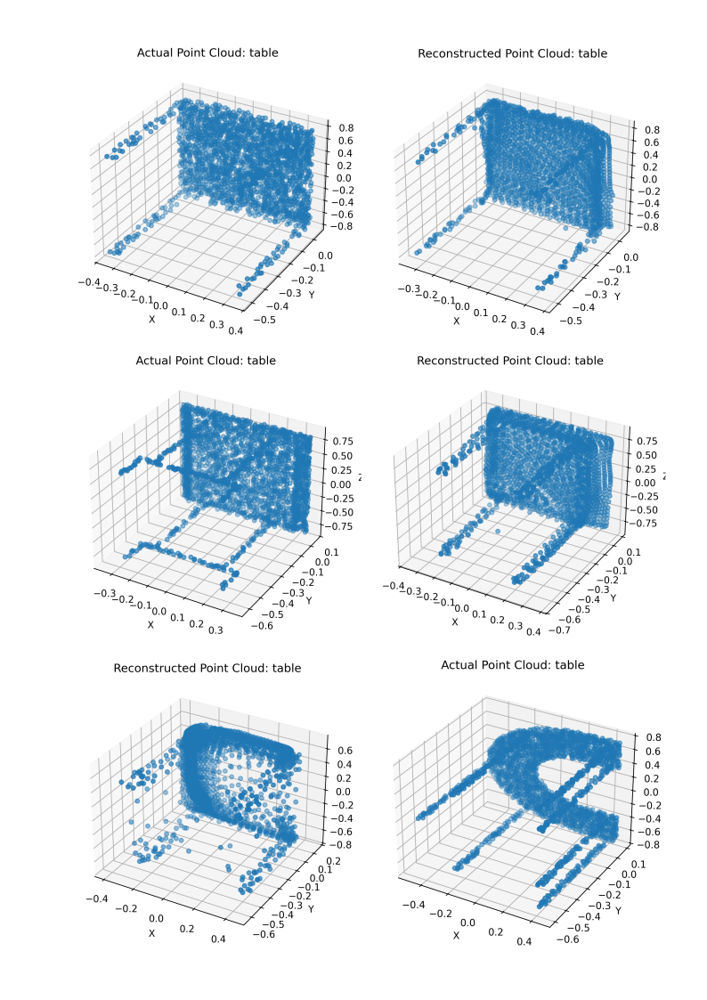
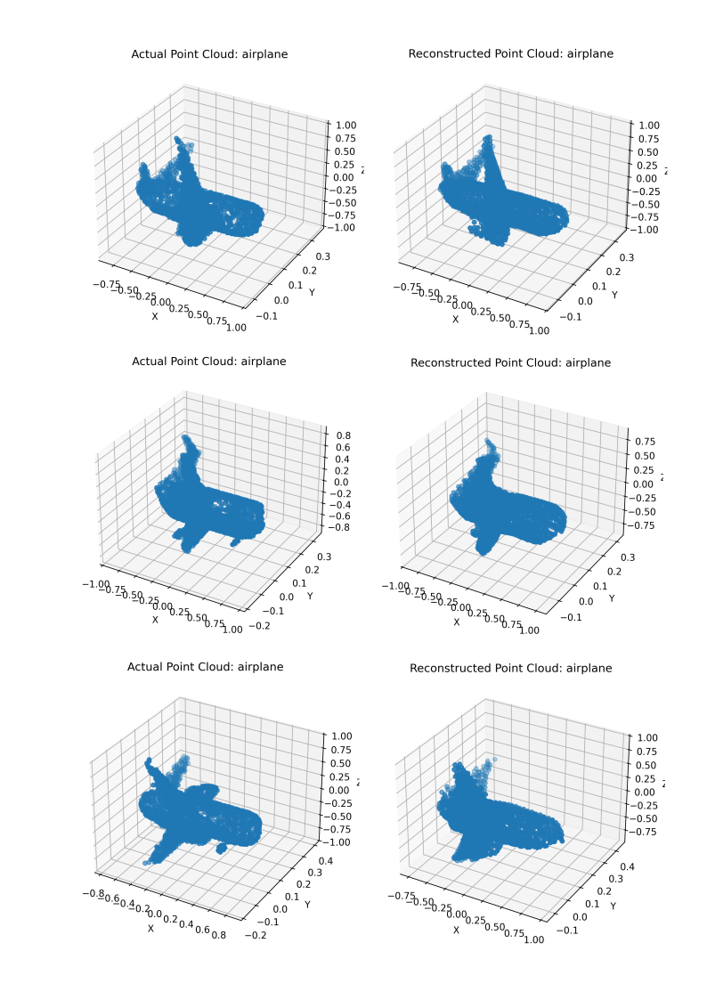

# FoldingNet + Sparse-Bregman 🧩

---


## Description

This project is a from-scratch PyTorch implementation of FoldingNet, the point-cloud auto-encoder introduced in *FoldingNet: Point Cloud Auto-encoder via Deep Grid Deformation*. It also explores an alternative optimization strategy: the Sparse Bregman Optimizer, with the goal of comparing it against the optimizer used in the original work.

FoldingNet learns a global representation of a 3D shape and reconstructs the point cloud by deforming a 2D grid. The research extension investigates whether sparsity can be encouraged through the optimization process rather than solely through objective-function regularization. The Sparse Bregman integration is still in progress, so optimizer comparison experiments have not yet been completed.

## Table of Contents

* [Description](#description)
* [Features](#features)
* [Tech Stack](#tech-stack)
* [Project Motivation](#project-motivation)
    * [Academic](#1-academic)
    * [Personal](#2-personal)
* [Model Architecture](#model-architecture)
* [Installation](#installation)
* [Usage](#usage)
  * [Dataset](#dataset)
  * [Configuration](#configuration)
  * [Training](#training)
  * [Evaluation](#evaluation)
* [Project Structure](#project-structure)
* [Example Results](#example-results)
* [Known Issues and Future Work](#known-issues-and-future-work)
* [References](#references)
* [License](#license)

## Features

* 🧠 **FoldingNet implementation:** Point-cloud encoder and folding-based decoder based on the original paper.
* 🔷 **Grid-based reconstruction:** Deforms a 2D grid into a reconstructed 3D point cloud.
* 📦 **ShapeNetPart data support:** Uses the HDF5 and/or .npz ShapeNetPart dataset layout.
* ⚙️ **Optimizer research:** Includes the default optimizer used by the project and an ongoing Sparse Bregman optimizer integration.
* 🚀 **Performance Profiling and Optimization:** Features NVTX instrumentation for profiling.
* 🧪 **Training and evaluation entry points:** Run the model with `src/main.py` and evaluate it with `src/eval.py`.

## Tech Stack

* **Core:** Python 3.13+, PyTorch
* **Dependency management:** uv
* **Model domain:** 3D point clouds and deep learning
* **Dataset format:** HDF5, NumPy zipped files (.npz)

## Project Motivation

There are two motivational drivers that inform this project: academic and personal.

### 1. Academic

3D point clouds are a fundamental representation used in areas such as:

* autonomous driving
* robotics
* augmented and virtual reality
* 3D reconstruction

However, point clouds are **unordered and irregular**, which makes them challenging for traditional neural network architectures. FoldingNet addresses this challenge by learning a **latent representation of a 3D shape** and reconstructing it by **deforming a 2D grid into the target geometry**.

Beyond the data modality and model architecture, optimization strategies are a very important aspect of deep learning. These strategies often work in tandem with some sort of objective function, which is usually augmented with regularization terms in a attempt to force the trained model into adopting desirable qualities. However, regularization terms are a passive means of ensuring desired properties i.e., parameter sparsity. A good question to ask is: can we enforce sparsity by altering, not the objective function, but the optimization strategy itself?

The Bregman framework is the answer to this question. This optimization framework allows neural networks to be trained from scratch, such that the optimization process only yields non-zero parameters when special mathematical circumstances necessitate this. This enforces sparsity as an internal measure of the optimization process itself.

### 2. Personal

This project stands as a dive into the worlds of point clouds and 3D data science. It also serves to link this space  to the field of graph processing, which is of strong interest.

## Model Architecture

The implementation follows the architecture proposed in the original FoldingNet paper.

### Encoder

The encoder extracts a global shape descriptor from the input point cloud using:

* Graph-based feature extraction
* Local covariance features
* Global max pooling

### Folding-Based Decoder

The decoder reconstructs the shape through two folding operations:

1. Begin with a 2D grid.
2. Concatenate the grid with the encoder's latent vector.
3. Apply two successive MLP folding layers.
4. Deform the grid into the reconstructed 3D point cloud.


<p align="center"><strong>FoldingNet architecture</strong></p>

### Implementation Details

The implementation follows the hyperparameters described in the original paper, with one stated modification: the batch size is $16$ rather than $1$ to improve training speed. Other architectural and training settings are intended to remain consistent with the original work.

## Installation

Install [uv](https://docs.astral.sh/uv/getting-started/installation/) and Python 3.13 or later, then clone the repository and install its dependencies:

```bash
git clone https://github.com/Harkhymadhe/sparse-bregman.git
cd sparse-bregman
uv pip install -e .
```

## Usage

### Dataset

> [!Important]
 > The dataset is obtained from Baidu and should be decompressed into the repository's `src/data/` directory. The expected dataset folder is `shapenetpart_hdf5_2048`; see [Project Structure](#project-structure) for the file layout.

### Configuration

Training and evaluation hyperparameters are currently configured in `src/main.py` and `src/eval.py`. Edit the relevant script parameters before running an experiment.

### Training

Start model training with one of the below:

```bash
python3 src/main.py
```

```bash
make run
```

### Evaluation

Evaluate trained model with:

```bash
python3 src/eval.py
```

```bash
make eval
```

### Profiling

To profile the performance of the training process, the `main.py` script is annotated via **NVTX**. To execute the profiling script, run the below:

```bash
make profile
```

## Project Structure

```text
.
├── LICENCE.md
├── README.md
├── notebook.ipynb
├── outputs/
├── pyproject.toml
└── src/
    ├── artefacts/
    ├── conf/
    │   └── config.yaml
    ├── data/
    │   └── shapenetpart_hdf5_2048/
    │       ├── test0.h5
    │       ├── test0_id2file.json
    │       ├── test0_id2name.json
    │       ├── test1.h5
    │       ├── test1_id2file.json
    │       ├── test1_id2name.json
    │       ├── train0.h5
    │       ├── train0_id2file.json
    │       ├── train0_id2name.json
    │       ├── train1.h5
    │       ├── train1_id2file.json
    │       ├── train1_id2name.json
    │       ├── train2.h5 ... train5.h5 and corresponding JSON files
    │       └── val0.h5 and corresponding JSON files
    ├── eval.py
    ├── logs/
    ├── main.py
    └── sparse_bregman/
```

The dataset tree above is abbreviated for readability.

## Example Results

The following images show examples of point clouds reconstructed by the trained model:

<p align="center">
  
  
</p>
<p align="center"><strong>Reconstruction examples from the trained model</strong></p>

## Known Issues and Future Work

This repository is currently focused on architectural reproduction. The following limitations remain and identify potential next steps.

### Sparse Bregman Optimizer Integration

The optimizer comparison is incomplete. At present, only `LinearBregmanOptimizer` and the default AdamW optimizer are supported; other Bregman optimization schemes are still a work in progress. Complete the update rules, integrate the optimizer variants into the training pipeline, and run controlled comparisons of reconstruction quality, convergence, and stability.

### Training and Benchmarking

The implementation uses batch size $16$ instead of the original batch size $1$, which changes the number of iterations and may affect gradient stability, convergence, and reconstruction quality. Investigate the effect of batch size and learning-rate adjustments; gradient accumulation, mixed precision, and multi-GPU training are possible avenues. Broader benchmarking should also include standard point-cloud datasets, comparisons with the FoldingNet paper, and ablation studies.

### Reproducibility and Logging

Experiment settings are embedded in `main.py` and `eval.py`, and logging is currently limited to terminal output. Add explicit random seeds, move hyperparameters into a separate configuration mechanism (for example, argparse, YAML, or dataclasses), and introduce structured experiment logging such as Loguru, TensorBoard, or Weights & Biases.

### Objective Function

The project uses a custom form of Chamfer distance. Verify its implementation and assess whether alternative aggregation modes, in addition to the current sum, affect training or reconstruction quality.

### Visualization and Data Augmentation

Add integrated point-cloud visualization (for example, with Open3D or PyVista) and investigate ways to communicate point-level structure, such as estimated normals or colors associated with the deformed grid. Data augmentation is also a potential improvement; options include point subsampling, coordinate jitter, and cloud rotation.

### Grid Granularity and Point-Cloud Size

The grid range was changed from approximately `[-22.5, 22.5]` to `[-3.0, 3.0]`, with the smaller range observed to produce better visual results. Further experiments are needed to test this hypothesis systematically. The current HDF5 data is limited to at most 2,048 points per cloud; work is ongoing to obtain higher-resolution data and implement point sampling.

## References

1. [FoldingNet: Point Cloud Auto-encoder via Deep Grid Deformation (2019)](https://arxiv.org/abs/1712.07262)
2. [A Bregman Learning Framework for Sparse Neural Networks (2024)](https://jmlr.org/papers/v23/21-0545.html)

## License

The project README identifies the license as MIT. See `LICENCE.md` for the license text.

